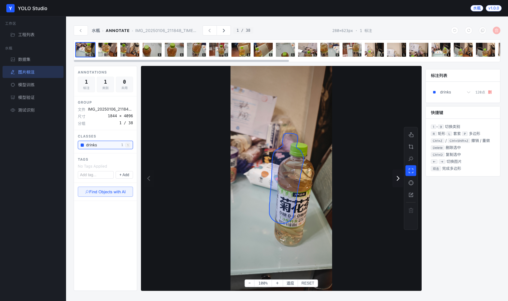
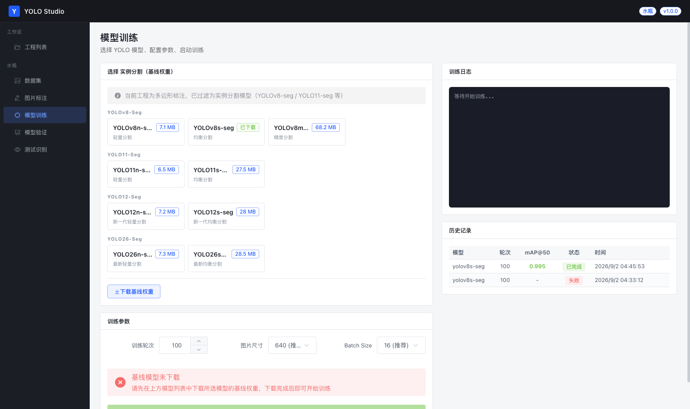

# 🎯 YOLO Studio — 本地 YOLO 模型构建平台

类 **Roboflow** 的本地化目标检测/实例分割模型构建工具。从图片上传、AI 辅助标注、数据集划分，到真实 YOLO 训练、指标验证、模型测试与导出，全流程开箱即用。

> 界面严谨高效 · 训练/推理全部真实（Ultralytics）· 数据本地存储 · 国内源加速下载

---

## ✨ 核心特性

| 模块 | 能力 |
|------|------|
| 🗂 **工程管理** | 矩形框（检测）/ 多边形（分割）工程、类别配置、数据集划分比例 |
| 🖼 **数据集** | 批量拖拽上传、全部/训练/验证/测试/已标注/未标注多维筛选、分页加载、标注角标 |
| ✏️ **图片标注** | 矩形框、PS 风格**套索**（自由圈选）、多边形、逐顶点编辑、8 手柄缩放、Ctrl+Z 撤销 |
| 🤖 **AI 辅助标注** | YOLOv8 预训练模型一键自动检测生成标注框 |
| 🧠 **Smart Select** | **SAM 精确智能分割**：智能框选（画框分割）+ 智能点选（左键加点/右键排除/回车确认），多边形轮廓直接标注 |
| 🚀 **模型训练** | YOLOv8 / YOLO11 / YOLO12 / YOLO26 全套检测模型 + **-seg 分割系列**（按工程类型自动过滤）、逐 epoch 真实指标实时回传、MPS/GPU 加速 |
| 📊 **模型验证** | mAP@50 / mAP@50:95 / Precision / Recall、逐 epoch 训练曲线、混淆矩阵、预测样例等真实产物、**多模型版本切换对比** |
| 📤 **测试识别** | 选择任意训练版本推理、检测框可视化、置信度统计 |
| 📦 **模型导出** | 下载 best.pt（PyTorch）、导出 ONNX / TorchScript 部署格式 |
| ⬇️ **国内源下载** | 模型权重（含 SAM 375MB）走国内 GitHub 加速镜像，**实时下载进度条** |

---

## 🖼 界面预览

> 📌 截图占位：将截图放入 `docs/screenshots/` 目录（同名文件），刷新即可显示。
> 可参考下方建议文件名自行截图替换。

| | |
|---|---|
| **工程列表** | **数据集管理** |
|  |  |
| **图片标注（AI 辅助 + 智能分割）** | **模型训练** |
|  |  |
| **模型验证（多模型切换 + 产物）** | **测试识别** |
|  |  |

---

## 🧱 技术栈

**后端**
- Python 3.9+ · FastAPI · SQLAlchemy (async) · SQLite
- Ultralytics（真实训练/推理/导出）· torch (MPS/CPU) · SAM
- Pillow / OpenCV / NumPy

**前端**
- Vue 3 (Composition API) · Element Plus · Vue Router 4
- Vite · Axios

---

## 🚀 快速开始

### 环境要求
- Python 3.9+（推荐 3.10+）
- Node.js 18+
- Apple Silicon (MPS) 或 NVIDIA GPU 可加速训练；纯 CPU 也可运行

### 1. 启动后端（端口 8000）

```bash
cd backend
python -m venv venv && source venv/bin/activate
pip install -r requirements.txt
uvicorn main:app --reload --port 8000
# 或 python main.py
```

- API 文档（Swagger）：http://localhost:8000/docs
- 首次启动自动创建 `data/`（数据库、uploads、models、outputs）

### 2. 启动前端（端口 3000）

```bash
cd frontend
npm install
npm run dev
```

浏览器打开 http://localhost:3000

---

## 📋 完整使用流程

```
1. 新建工程 ── 选标注类型（矩形框/多边形）、配置类别（如 drinks/person/car）
2. 上传图片 ── 数据集页拖拽批量上传，自动归入训练集
3. 图片标注 ──
   · AI 辅助：一键检测自动生成框（需先下载 yolov8s 基线，自动匹配工程类别）
   · 智能分割：画框 / 点击加区域，SAM 生成精确多边形（需先下载 SAM 模型）
   · 手动：矩形 / 套索 / 多边形 + 顶点编辑
4. 数据划分 ── 按比例自动划分 训练/验证/测试
5. 模型训练 ── 选模型（检测 or 分割，按工程自动过滤）→ 下载基线 → 开始训练
6. 模型验证 ── 指标、曲线、混淆矩阵；多模型版本切换对比；导出权重
7. 测试识别 ── 选模型版本 → 上传图片推理
```

---

## 📁 项目结构

```
yolo_builder/
├── backend/
│   ├── api/                  # FastAPI 路由
│   │   ├── projects.py       # 工程 CRUD（删除含训练产物）
│   │   ├── images.py         # 图片上传 / 划分
│   │   ├── annotations.py    # 标注 CRUD / 改类别
│   │   ├── training.py       # 真实训练 / 多模型 / 下载进度 / 导出
│   │   ├── inference.py      # 推理（线程池，不阻塞）
│   │   └── ai_annotate.py    # AI 标注 / Smart Select / SAM 下载
│   ├── core/
│   │   ├── config.py         # 配置（自动建目录）
│   │   ├── database.py       # async SQLAlchemy
│   │   └── dataset.py        # YOLO 数据集导出（detect/segment 自动）
│   ├── models/               # SQLAlchemy 模型
│   ├── data/                 # 运行时数据（勿提交 git）
│   ├── main.py
│   └── requirements.txt
├── frontend/
│   ├── src/
│   │   ├── api/index.js      # API 封装
│   │   ├── views/            # Layout/Projects/Dataset/Annotate/Train/Evaluate/Test
│   │   ├── components/       # TrainingChart 等
│   │   └── assets/styles/    # 全局工业风样式
│   ├── package.json
│   └── vite.config.js
├── docs/screenshots/         # 界面截图（README 展示位）
└── README.md
```

---

## 🔌 API 概览

| 方法 | 路径 | 说明 |
|------|------|------|
| GET/POST/PUT/DELETE | `/api/projects`... | 工程管理（删除级联清理训练产物） |
| POST | `/api/projects/{id}/images/upload` | 批量上传 |
| POST | `/api/projects/{id}/auto-split` | 按比例自动划分 |
| POST | `/api/projects/{id}/ai-annotate` | AI 辅助标注（YOLO 检测） |
| POST | `/api/projects/{id}/smart-select` | Smart Select（SAM 分割） |
| POST | `/api/projects/{id}/train` | 启动真实训练 |
| GET | `/api/runs/{id}` | 训练状态/进度/日志 |
| GET | `/api/projects/{id}/runs/{rid}/download` | 下载 best.pt |
| POST | `/api/projects/{id}/runs/{rid}/export` | 导出 ONNX/TorchScript |
| GET | `/api/models/available` | 模型列表（含已下载标记） |
| POST | `/api/models/download/{id}` | 下载基线（国内源+进度） |
| GET | `/api/sam/status` | SAM 模型状态 |
| POST | `/api/sam/download` | 下载 SAM（国内源+进度） |

---

## 💡 说明与提示

- **训练日志**按时间正序展示，最新在底部
- **未下载模型不能训练**：前端按钮禁用 + 后端 400 拦截
- **模型按工程类型过滤**：矩形框工程→检测模型；多边形工程→分割模型（-seg）
- **多模型并存**：每次训练生成独立版本，Evaluate/Test 可切换
- **分割训练**：多边形标注导出原始轮廓；若含矩形标注自动转 4 角点
- **数据安全**：删除工程时数据库记录 + 上传图片 + 训练产物一并清除

---

## 📄 License

[MIT](LICENSE)
